# English site: why it looks off, and how it was fixed

Status: direction A2 "Bold Bands" with Outfit headings is now built on the English pages (not yet committed or deployed). The sections below record how the direction was chosen.

## What was built

- Chosen: direction A2 with Outfit (headings) and Figtree (body). Both fonts are self-hosted through the `@fontsource-variable` packages, so the site makes no request to Google.
- All English styling lives in `src/styles/en.css`. Every rule is scoped to `html[lang='en']`.
- Small English-only branches in shared components: the COL-only logo in `Header.astro` and `Footer.astro` (`public/logo-en.png`, `public/logo-en-white.png`), and number units in `Blocks.astro`.
- English wording tweaks in `src/content/en.ts`: dot-separated hints became short phrases, the footer ticker lost its Chinese half, and "Up next · NEXT" became "Up next".
- The old English override block in `src/styles/global.css` was removed; it only ever applied to English pages.
- Checked: all eight English pages plus an IP detail page and a news article, in light and dark, and the home and Business pages at phone width. The nine Chinese pages were compared pixel by pixel with screenshots taken before the change; the only differences are the live share price in the header and video frames.
- The COL-only logo files are cropped from the existing logo. Replace them with a proper export from the brand file when available.

## Round 2. Direction A2, "Bold Bands" (current proposal)

Feedback on round 1, and what it changed:

| Feedback | Result |
|---|---|
| Not B: no serif, no editorial | B is dropped |
| C's centred layout feels far from the Chinese site | A2 stays left-aligned like the Chinese site; nothing is centred |
| A is too close to what we have now | A2 replaces the tile mosaic and text cards with bands and rows, and uses a more distinctive heading font |
| No need to match the col-distribution.com fonts | Heading font chosen on its own merits (eight sans-serif options below) |
| The site has a light and a dark version | A2 is designed in both |
| The team wants the 7 posters in the hero | The same 7 posters in the same hand-placed positions as the Chinese home page |
| Show product logos where the Chinese site shows them | Product rows carry the logos, with the dark-mode logo files in dark mode |
| Use the COL logo without Chinese | Header uses the "COL" mark alone |

Prototype: [`a2.html`](en-design-proposal/prototypes/a2.html). The small panel at the bottom right switches Light / Dark and the heading font. The screenshots below use Sora.

Home, light:

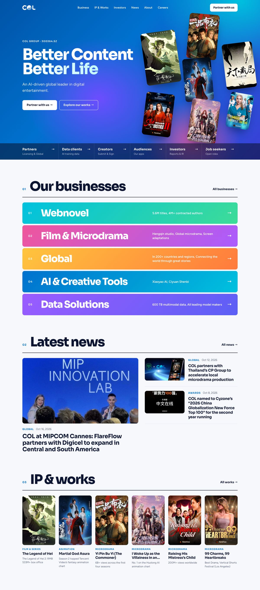

Home, dark (below the hero, which is the same in both modes):

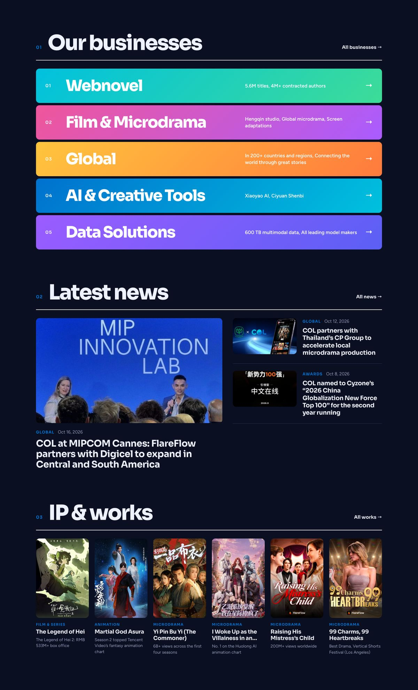

Business page excerpt, light:

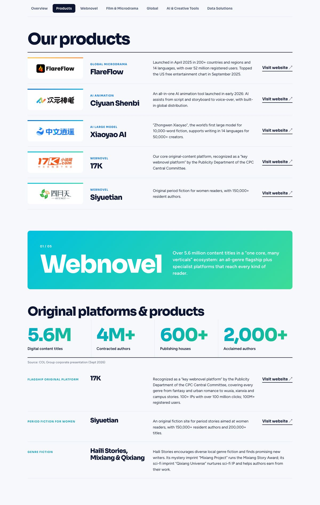

Business page excerpt, dark:

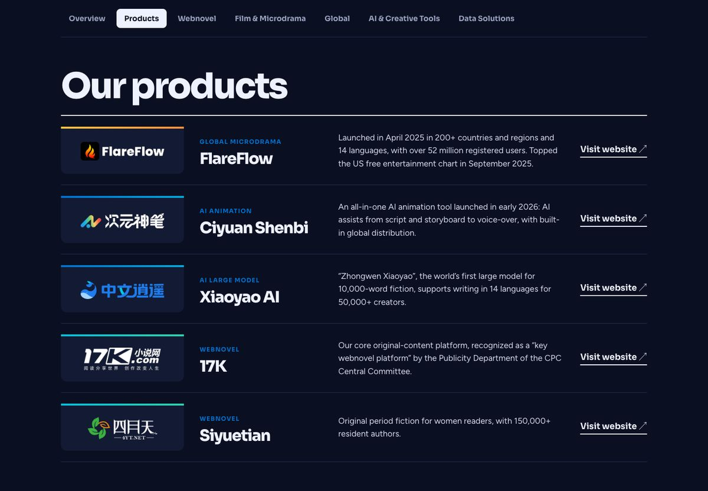

What is different from the current English site:

- Hero: same blue background and 7 posters. The headline is 86 to 98 px (depending on the font) at weight 800 (now 92 px at weight 500). The floating white quick-links card becomes a bar that closes the hero, with one short phrase per audience.
- Section headings: 72 px bold with a section number, sitting on a rule (now 44 px medium with a gradient on the first word).
- Businesses: five full-width colour bands in the existing theme gradients, with a 54 px name and the hook as a sentence. This replaces the tile mosaic.
- Products: one row per product: logo, category and name, description, link. This replaces the five product cards and shows every logo the Chinese page shows.
- Platform lists and similar text cards: rows in the same four columns, so long and short entries sit together with no half-empty boxes.
- Stats: one ruled row, 80 px bold figures with the unit attached ("5.6M"), in the chapter's theme colour.
- Chapter openers: the coloured banner stays, with a 112 px title.
- News: one lead story and two beside it. IP: posters with no white frame, titles clamped to two lines.
- Corners: 12 px (now 28 px). Page menu: horizontal bar under the header (now a left-hand column).

Heading font options. All are free Google Fonts and all are sans-serif. Sora is the current front-runner and the prototype's default; the font menu in the prototype switches between all eight.

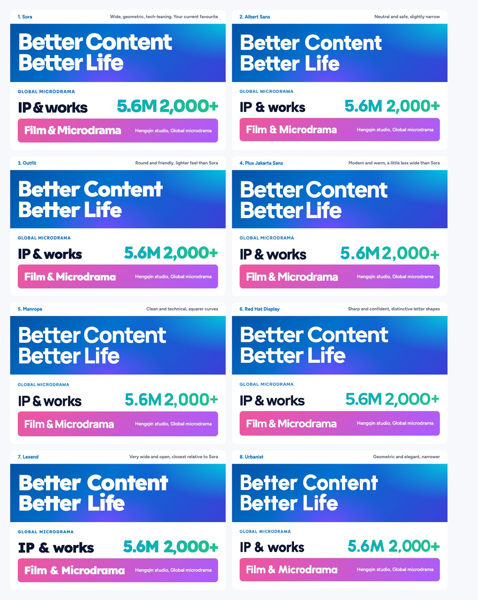

| # | Font | Character |
|---|---|---|
| 1 | Sora | Wide, geometric, tech-leaning |
| 2 | Albert Sans | Neutral and safe, slightly narrow |
| 3 | Outfit | Round and friendly, lighter feel than Sora |
| 4 | Plus Jakarta Sans | Modern and warm, a little less wide than Sora |
| 5 | Manrope | Clean and technical, squarer curves |
| 6 | Red Hat Display | Sharp and confident, distinctive letter shapes |
| 7 | Lexend | Very wide and open, the closest relative to Sora |
| 8 | Urbanist | Geometric and elegant, narrower |

Sora and Lexend are wide, so the hero headline is set a little smaller with them (about 86 px) to keep it clear of the posters. Standalone comparison page: [`fonts.html`](en-design-proposal/prototypes/fonts.html). Body text is Figtree in every option.

Notes:

- The "COL" mark in the prototype is cropped from the existing `public/logo.png`. For the real build it should be exported from the brand file (`COL_LOGO（全）.ai`).
- Xiaoyao AI has only one logo file, so it is the same in light and dark.
- Still to design during the build: IP & Works, About, Investors, News, Careers and Partner pages, phone layouts, and animations.

Decisions: A2 was built, with Outfit as the heading font. Very long titles are shortened with "…" on grid pages; the full title shows on the detail page.

- Scope: `/en/` pages only. The Chinese site stays exactly as it is.
- Unchanged in every direction: sitemap, page structure, all content, brand colours.
- Measured on a 1440 px wide desktop window, from the current build of this branch.
- Round 1 prototypes: [`a.html`](en-design-proposal/prototypes/a.html), [`b.html`](en-design-proposal/prototypes/b.html), [`c.html`](en-design-proposal/prototypes/c.html). They are standalone mock pages that use the real English text and real posters. They are not part of the site.

## Part 1 (round 1). Why the current English version looks weird

The root cause is the same everywhere: the layout was sized for Chinese, where 4 characters make a heading and 30 characters make a paragraph. The same boxes now hold English text that is 2.5 to 4 times longer and much lighter in colour on the page. The existing English override (about 50 `!important` rules at `src/styles/global.css:238` onward) changes fonts and weights, but the boxes, grids and proportions are still the Chinese ones.

### 1. The headline lost its weight, and the hero now belongs to the posters

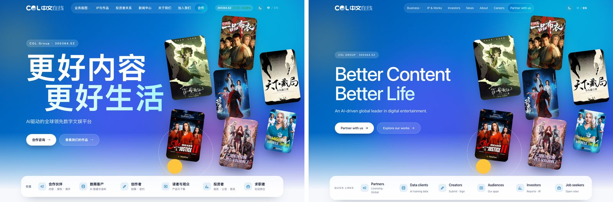

| | Chinese | English |
|---|---|---|
| Hero headline size | 140 px | 92 px |
| Hero headline weight | 900 (black) | 500 (medium) |
| Section heading | 52 px, weight 800 | 44 px, weight 500 |

Chinese characters are dense squares, so the Chinese headline is a solid block that balances seven colourful posters. The English headline is two-thirds the size and half the weight, so the posters win and the left side looks empty. Files: `src/pages/index.astro` (hero styles), `src/styles/global.css:245`.

### 2. Paragraphs sit in columns that are too narrow for English

Comfortable English reading is 45 to 75 characters per line. Card text on the English site runs at 25 to 32.

| Card text | Chinese | English |
|---|---|---|
| Characters per line in a 3-column card | 13 to 17 (fine for Chinese) | 25 to 32 (too short) |
| Lines in the 17K platform card | 4 | 9 |
| Characters in one row of three cards | 87 / 39 / 99 | 293 / 166 / 296 |

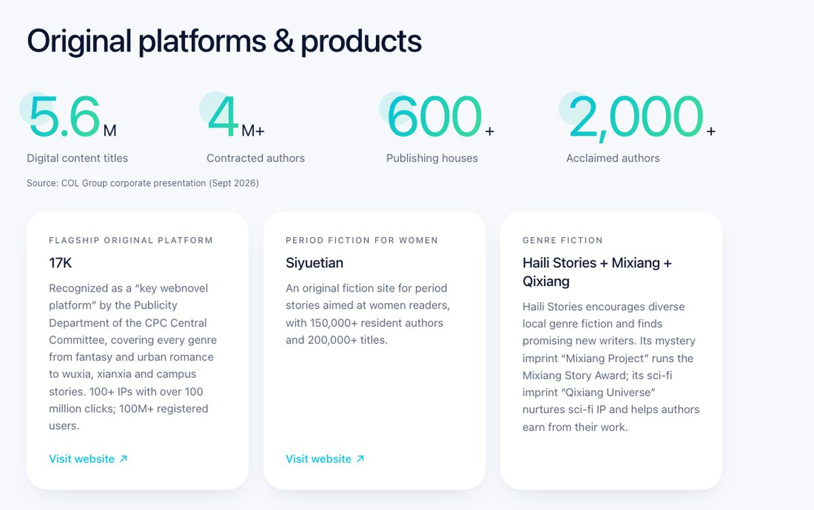

The result is tall, thin, ragged paragraphs. Because cards in a row are forced to the same height, a short card (Siyuetian, 166 characters) sits next to two long ones (about 295) and is half empty. Two things cause the narrow columns: the 3-column card grids in `src/components/zh/Blocks.astro`, and the 196 px left-hand page menu (`src/styles/global.css:226`), which leaves only 920 px for content, so each card gets 240 px of text.

### 3. Long English titles break the poster grids

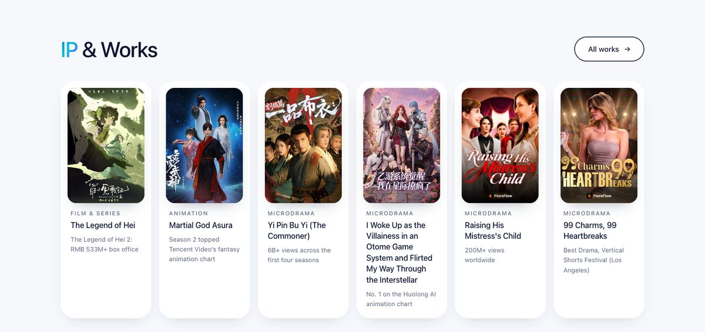

The six IP cards on the home page are 145 px wide. Chinese titles are 4 to 14 characters and fit in one or two lines. "I Woke Up as the Villainess in an Otome Game System and Flirted My Way Through the Interstellar" wraps to 6 lines there and 4 lines on the IP page, so that one card stretches the whole row and the others end in blank white space. Files: `src/pages/index.astro` (`.ip-feature`, `.ipf`), `src/components/zh/Blocks.astro:894` (`.ip-grid`).

### 4. Numbers are split into a big digit and a tiny unit

In Chinese, "560 万种" reads naturally as a number plus a small unit. English keeps the same split, so "5.6M" is drawn as a 76 px "5.6" with a 22 px "M" hanging off it, and "490K+ hrs" becomes a big "490" with small "K+ hrs". In English the M or K is part of the number, and readers see "5.6" and "4" first, which is the wrong figure. The pale circle behind the first digit also reads as a rendering glitch at this weight. Files: `src/styles/global.css:129` to `136`, stat blocks in `Blocks.astro`.

### 5. The gradient highlight lands on the wrong word

Section headings colour their first part with the brand gradient. In Chinese that is the key word ("**业务**版图"). In English it lands on "**Our** Businesses" and "**IP** & Works", so the emphasis falls on a filler word. File: `src/content/en.ts:873` and `:877`, styled at `src/styles/global.css:89`.

### 6. Too much tiny grey text

Latin letters are smaller than Chinese characters at the same font size, so 12 to 13 px text that is fine in Chinese is hard to read in English. Share of visible text under 14 px:

| English page | Text under 14 px |
|---|---|
| Home | 46% |
| Careers | 43% |
| IP & Works | 39% |
| Investors | 32% |
| About | 27% |

Much of it is also uppercase with wide letter spacing (category labels at 11.5 px), which is used so often that it stops working as a label.

### 7. Two type styles are mixed on the same page

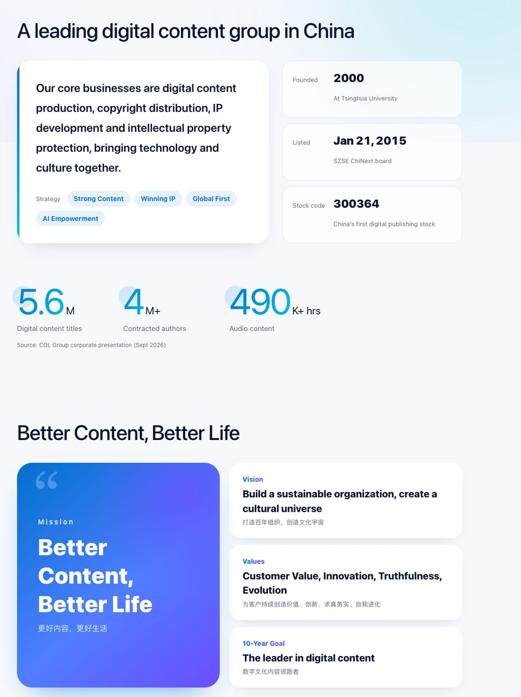

The override makes most headings light (weight 500), but components it does not list keep the Chinese heavy weights. On the About page a light "A leading digital content group in China" sits above a black-weight "Better Content, Better Life" card and black-weight "2000 / 300364" figures. Other leftovers: "See our open roles" on Careers (72 px, weight 900), the pink "80% / 90% / 1,200" figures on Business (weight 900), the share price on Investors, and the footer ticker. Files: `Blocks.astro:595`, `:610`, `:627`.

### 8. Line spacing and letter spacing tuned for Chinese

- Chinese needs generous line spacing (1.8 to 2.0). Several English paragraphs still use it: the About lead paragraph (1.75 at 24 px, `Blocks.astro:579`), the animation paragraph on Business (1.95, `Blocks.astro:572`), the chairman's letter on Investors (1.9). In English this looks double-spaced.
- The "Mission" label has 0.2em letter spacing, which reads as "M i s s i o n" (`Blocks.astro`, `.cu-k`).

### 9. Keyword lists joined with dots

Chinese sub-labels are short keyword lists: "内容 · 授权 · 海外". The English keeps the form: "Licensing · Global", "Submit · Sign", "Hengqin studio · Global microdrama · Screen adaptations". English readers expect a short phrase, and on the home page the quick-links box is so narrow that "Licensing · Global" wraps onto two lines (96 px wide, `src/pages/index.astro:216`). This is a presentation fix (join with commas or "&"), not a content change.

### 10. Big coloured tiles with a small title in the corner

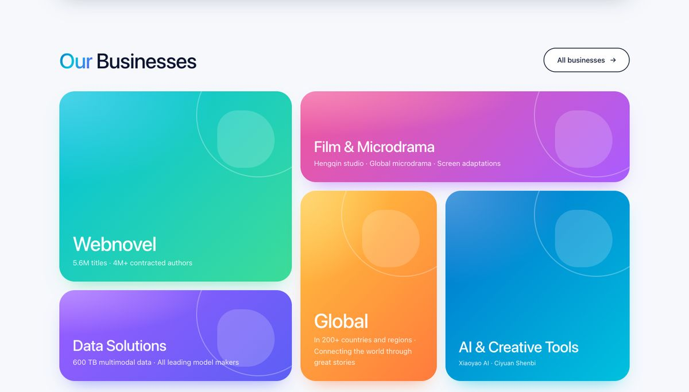

The business tiles on the home page were composed around a 46 to 58 px, black-weight Chinese title plus a small English caption above it. In English the caption is hidden (it would repeat the title) and the title is 32 to 42 px at medium weight, so each tile is mostly empty gradient. File: `src/components/zh/BizPosters.astro:62`.

### 11. Chinese left over on English pages

- Chinese subtitles under the English mission, vision and values on About (`Blocks.astro:50`, `:57`).
- "更好内容 更好生活" in the big footer ticker (`src/components/zh/Footer.astro:11`).
- The header logo is the Chinese wordmark "COL 中文在线". col-distribution.com uses a plain "COL" mark. Worth asking the brand team which logo the English site should carry.

### 12. Everything is a rounded white card

Rounded 28 px white cards with soft shadows are a common Chinese web style and suit short Chinese text. With English text they turn every section into a row of text boxes of uneven fill (points 2 and 3). English corporate and media sites lean on type size, rules and white space, and keep boxes for things that are truly objects (a product, a poster, a news story).

## Part 2 (round 1). What is the same in all three directions

These fixes answer the list above and do not depend on taste:

1. Units go inside the number: "5.6M", "490K+ hrs" at one size.
2. The left-hand page menu becomes a horizontal bar under the page header on English pages. Same links, same order, but content gets the full 1,190 px instead of 920 px.
3. Body text at 16 to 17 px, nothing below 13 px, line spacing 1.5 to 1.6.
4. Text columns held to 45 to 75 characters per line. That means at most two text cards side by side, or a list.
5. Long titles are clamped to two or three lines with "…" (the full title stays on the detail page).
6. Dot-separated hints become short phrases ("Licensing & Global").
7. The gradient goes on the key word or is dropped from headings.
8. Chinese subtitles and the Chinese half of the ticker are removed from English pages.
9. English gets its own stylesheet and, where the structure differs, its own components, in place of the current list of overrides. This is what stops point 7 from coming back.

## Part 3 (round 1). Three directions

### Fonts

The team asked to match col-distribution.com, which uses Alfabet (headings, bold) and Avenir LT (body). Both are paid fonts that Wix licenses for Wix sites only, so we cannot use them here. All fonts below are free Google Fonts under the Open Font License.

| Direction | Headings | Body | Relation to col-distribution.com |
|---|---|---|---|
| A | Albert Sans, bold | Nunito Sans | Closest free match: Albert Sans for Alfabet, Nunito Sans for Avenir |
| B | Newsreader (serif) | Inter | Different on purpose |
| C | Barlow Condensed, bold capitals | Barlow | Different on purpose |

### Direction A. Bold Sans (the sister-site match)

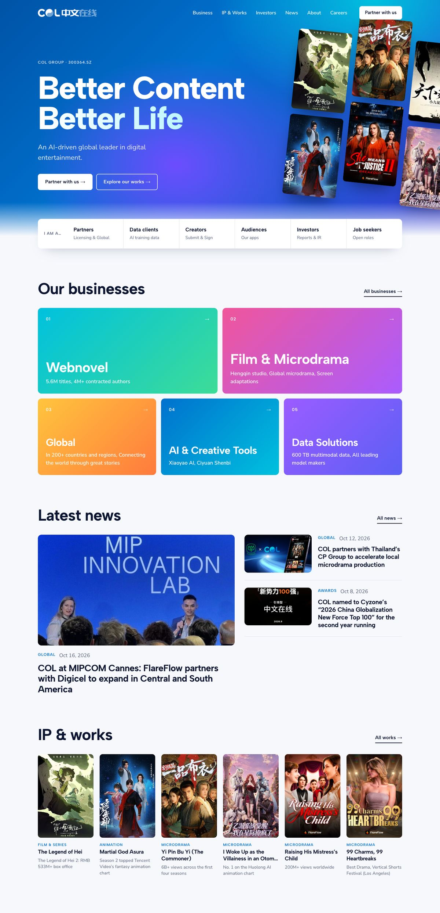

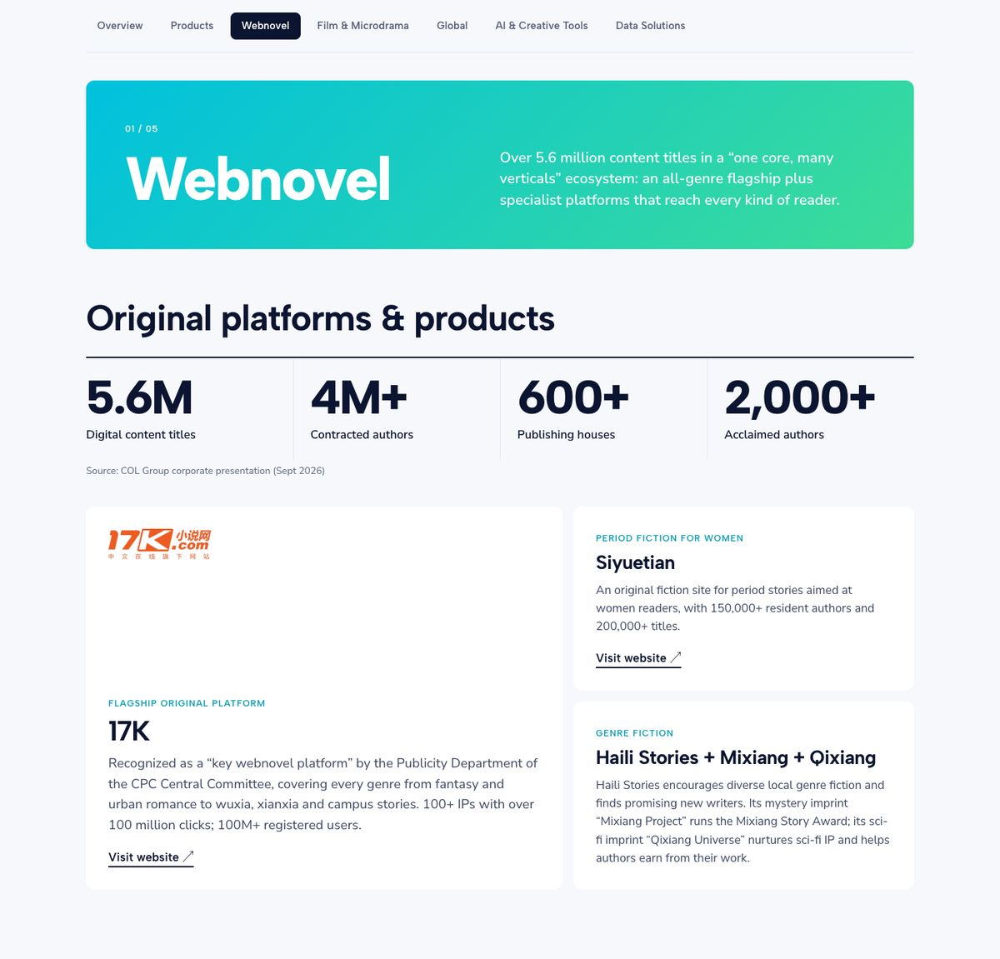

What changes:

- Type: heavy geometric sans headings (weight 700 to 800), sentence case, tight spacing. Hero headline 104 px, section headings 52 px. English gets its weight back through boldness, the way the Chinese site does.
- Cards: kept, but fewer and wider. Corners drop from 28 px to 12 px. Text cards are at most two across, with one lead card and smaller ones beside it, so no card is half empty.
- Business tiles: five flat colour tiles in the same theme gradients, numbered, with a large bold name and the hook as a sentence.
- Stats: one ruled row, bold numbers with units attached.
- News: one lead story with a large picture, two smaller stories beside it. Headlines of 90 characters fit.
- IP: posters without the white card frame; category, two-line title, one proof point.
- Hero: same blue background and posters as the Chinese site, with the posters in a tidy tilted grid.

Why it suits English: bold sans headings carry the same visual weight as Chinese headings, so pages keep the energy of the Chinese site. It looks like the sister site, which is what the team asked for. It is the smallest change, so the two languages still feel like one brand.

Trade-off: it is the least distinctive of the three. It is a well-made corporate site, and still card-based.

### Direction B. Editorial (no cards)

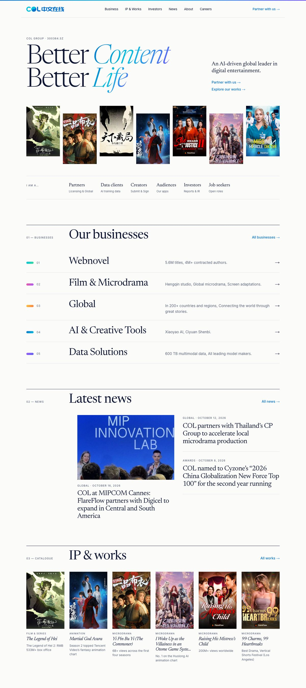

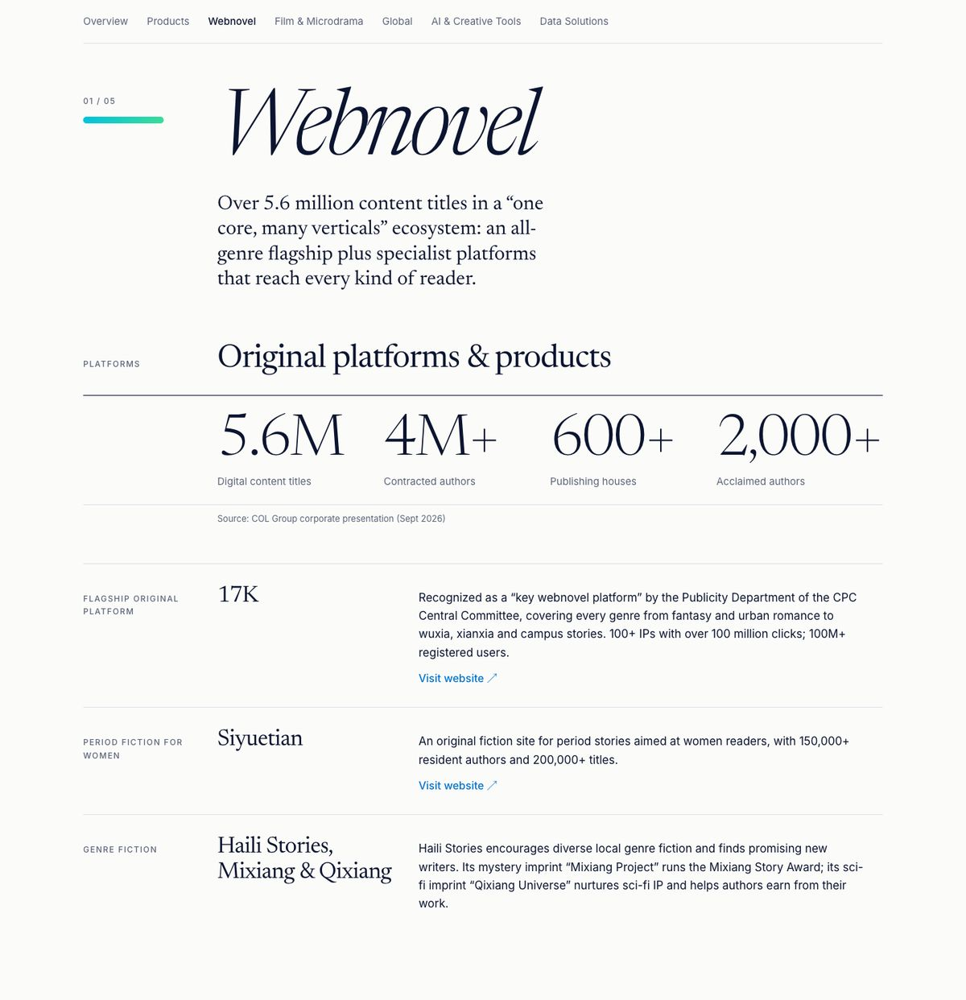

What changes:

- Type: a light serif for headlines, with italics in the brand gradient for the key words ("Better *Content*, Better *Life*"). Hero headline 124 px. Clean sans for body text and labels.
- Cards: none. Sections are separated by thin rules. A 200 px label column on the left carries section numbers and category labels, so the main column holds text at about 65 characters per line.
- Businesses: a numbered index of five rows: colour chip, large name, one-line description, arrow.
- Stats: a ledger row between two rules, in large light serif figures.
- Platform and product lists: label, name, description in three columns. Long and short entries sit together without any empty boxes.
- News: one picture story, the rest as headlines with dates.
- IP: a catalogue grid with italic titles, like a publisher's list.
- Hero: white background; the posters become a neat staggered strip under the headline.
- Colour: the palette is unchanged, but used sparingly: gradient on headline words, colour chips for the five businesses, blue links. The business gradients no longer fill large tiles.

Why it suits English: this is how English-language publishers and media groups present themselves, and COL is a publishing and stories company. Serif type is a Latin strength with no Chinese equivalent on the current site, so the English site gains its own character. Lists and rules absorb any text length, so the uneven-card problem disappears completely.

Trade-off: the biggest visual distance from the Chinese site and from col-distribution.com. Calmer and more "literary"; less of the colourful entertainment feel. Needs the most new layout work.

### Direction C. Showcase (dark, poster-first)

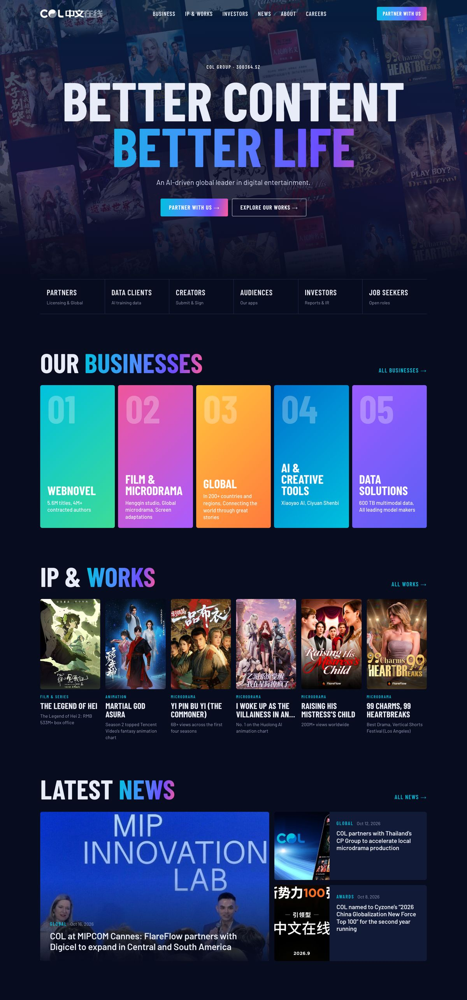

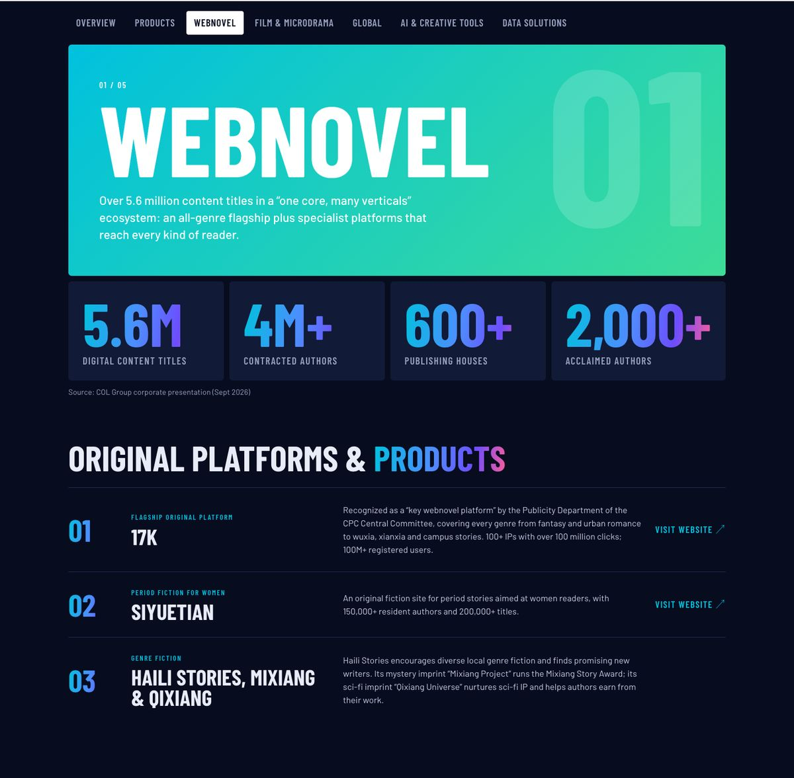

What changes:

- Type: tall condensed capitals for headlines (168 px in the hero), like film posters and streaming services. Condensed letters fit long English words into narrow spaces at a very large size.
- Background: dark navy on every English page, using the site's existing night colour. The brand gradient runs through headline words and figures.
- Hero: a wall of posters behind a centred headline.
- Businesses: five tall colour panels side by side, like a channel line-up.
- IP: comes second on the home page, ahead of news. Larger posters, capital titles.
- Stats: four dark panels with very large gradient figures.
- News: one story with the headline over the picture, two beside it.
- Lists: numbered rows with the description held to a readable width.

Why it suits English: international buyers of microdrama and animation are used to this look from Netflix, studio and distributor sites. Posters do the selling, and capital condensed type turns long English titles from a problem into the design.

Trade-off: a dark site is a colour decision. The palette is the same but the balance flips from light to dark, so this needs the team's agreement. Text-heavy pages (Investors, the chairman's letter, news articles) are less comfortable on dark and would need lighter panels. Furthest from "listed company" in tone.

### Side by side

| | A. Bold Sans | B. Editorial | C. Showcase |
|---|---|---|---|
| Feels like | Modern corporate, same family as the Chinese site | International publisher or media group | Studio or streaming service |
| Matches col-distribution.com | Yes | No | Partly (bold capitals, poster-led) |
| Cards | Fewer, wider | None | Panels for stats and news only |
| Colour use | Same as now | Same palette, used sparingly | Same palette on dark |
| Distance from Chinese site | Small | Large | Large |
| Best for | Partners, investors, general visitors | Investors, press, publishing partners | Content buyers, audiences |
| Build effort | Smallest | Largest | Medium to large |

## Round 1 recommendation (superseded by round 2)

Direction A as the base, with two things borrowed from B: the three-column list for platforms and products in place of text cards, and the ruled stats row. That keeps the English site in step with the Chinese site and the sister site, honours the font request as closely as free fonts allow, and removes the uneven-card problem where it is worst (the Business page).

C is worth considering for the IP & Works page alone if the team wants a stronger showcase for buyers.

## Round 1 questions (answered; see round 2)

1. Which direction: A, B, C, or a mix?
2. Logo on the English site: keep "COL 中文在线", or use a plain "COL" mark like col-distribution.com?
3. Is a dark English site acceptable (only matters for C)?
4. Is it acceptable to shorten very long titles with "…" on grid pages?

## How these were made

- "Before" screenshots and all measurements come from the built site (`npx astro build`), English and Chinese pages at 1440 px wide.
- The prototypes are three standalone HTML files in `docs/en-design-proposal/prototypes/`, sharing one content file (`data.js`) with text copied from `src/content/en.ts`. They load fonts from Google Fonts, so they need an internet connection.
- Each prototype shows the home page and one excerpt of the Business page (Webnovel chapter, stats, platform list). Other pages, phone layouts, dark mode and animations are not mocked yet.
